<div align="center">



<a href="https://drive.google.com/file/d/1JKxxEUasaeFE6d7Rjq4LOaeaBI5tI4Mz/view?usp=sharing"></a>

</div>

---

## 👨‍💻 About Me

```yaml
name:      Salah Said
role:      Cloud & DevOps Engineer
education: B.Sc. IT & Computer Science — Sinai University (Exp. Aug 2027)
focus:     AWS • Terraform • Docker • CI/CD • Linux • SRE • GCP • Azure
internships:
  - Vosyn Inc.   (Remote — Canada)
  - Ghaymah      (Remote — Egypt)
certified: AWS Solutions Architect – Associate ✅
```

Final-year IT & Computer Science student and **AWS Certified Solutions Architect – Associate** with hands-on DevOps and cloud engineering internship experience at **Vosyn Inc.** and **Ghaymah**. I design secure, highly available AWS architectures (VPC, ALB, Auto Scaling, IAM) and automate infrastructure and CI/CD pipelines with Terraform, Docker, GitHub Actions, Python, and Bash. Red Hat certified (SysAdmin I) with a strong interest in hybrid cloud solutions and site reliability engineering.

---

## 🚀 Currently

> **Cloud Engineering Intern @ Vosyn Inc.** *(Remote — Canada)*
> Building an **AI Gateway Real-Time Voice pipeline** — PCM audio streaming, GCP Speech APIs, Python, Docker, CI/CD.

---

## 💼 Experience

### Cloud Engineering Intern — Vosyn Inc. *(Remote — Canada)* · May 2026 – Present
- Designed and built an **AI Gateway Real-Time Voice pipeline** using PCM audio streaming, GCP Speech APIs, and Python; containerized with Docker and integrated into CI/CD on Linux.
- Collaborated with cross-functional remote teams to deliver cloud-native solutions aligned with enterprise scalability requirements.
- Built a **DASH/MPD manifest-stitching engine** (Python, lxml) for a Dynamic Ad Insertion (DAI) proof of concept; validated single- and multi-ad-break timeline alignment end-to-end in a real DASH player.

### DevOps Intern — Ghaymah *(Remote — Egypt)* · Jan 2025 – May 2025
- Automated infrastructure workflows with Python and Bash scripts, increasing operational efficiency.
- Managed AWS S3 storage and provisioned cloud resources ensuring high availability.
- Implemented Docker containers to streamline application deployment.
- Conducted log analysis and monitored system health using Grafana dashboards and alerts.
- Maintained Red Hat-based Linux servers for secure and stable production environments.

---

## 🛠️ Skills & Tools

<div align="center">


<br/>


</div>

<br/>

| Category | Stack |
|:--|:--|
| ☁️ **Cloud Infrastructure** | AWS (EC2, S3, VPC, RDS, Route53, IAM, Lambda, Load Balancer, Auto Scaling), GCP (Speech APIs) |
| 🏛️ **Cloud Architecture** | AWS Well-Architected Framework, High Availability & Fault Tolerance, Cost Optimization |
| 🏗️ **Infrastructure as Code** | Terraform |
| 🐳 **Containers & CI/CD** | Docker, GitHub Actions, CI/CD Pipelines |
| ⚡ **Automation** | Bash Scripting, Python |
| 📊 **Monitoring & Systems** | Grafana (Dashboards & Alerts), Linux Administration (Red Hat) |
| 🌐 **Networking** | VPC Design, Subnets, NAT, NACLs, Security Groups, DNS (Route53) |
| 🔌 **Integration** | API Integration & Testing, Git & GitHub |

---

## 📜 Certifications

<div align="center">

<a href="https://www.credly.com/badges/87302574-be0f-4afe-98ce-635f9b0a2955">
  
</a>

</div>

- 🏆 **AWS Certified Solutions Architect – Associate (SAA)** — Amazon Web Services *(Oct 2026 – Oct 2029)* · [Verify on Credly](https://www.credly.com/badges/87302574-be0f-4afe-98ce-635f9b0a2955)
- 🐧 **Red Hat Certified System Administrator I (RHCSA)** — MaharaTech ITI *(June 2025)*
- ☁️ **AWS Cloud 101** — Amazon Web Services *(July 2025)*
- 🌱 **AWS Emerging Talent** — Amazon Web Services *(May 2025 – July 2027)*

---

## 🎓 Education & Awards

- 🎓 **B.Sc. IT & Computer Science** — Sinai University *(Expected August 2027)*
- 🏅 **AWS Educate Recognition** (2025) · **Red Hat ITI Achievement** (2025)
- 🌍 **Languages:** Arabic (Native) · English (Upper-Intermediate, B2)

---

## 📫 Connect with me

<div align="center">

<a href="https://www.linkedin.com/in/salah-said-616093263/"></a>
<a href="https://medium.com/@salahsaid1"></a>
<a href="mailto:salahsaidr5@gmail.com"></a>
<a href="https://www.credly.com/badges/87302574-be0f-4afe-98ce-635f9b0a2955"></a>
<a href="https://drive.google.com/file/d/1JKxxEUasaeFE6d7Rjq4LOaeaBI5tI4Mz/view?usp=sharing"></a>

<br/><br/>


</div>
